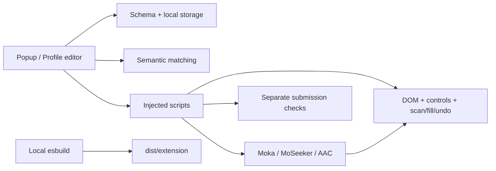

# 架构 / Architecture

1.8.0将1.7.0整理为可构建模块，保留页面交互、资料接口和适配器顺序。原网页助手保持原状。

Version 1.8.0 organizes the previous implementation into buildable modules while retaining interaction, data contracts and adapter order. The original web workspace remains in place.

| 层 / Layer | 源码 / Source | 职责 / Responsibility |
| --- | --- | --- |
| DOM | `src/extension/content/core/dom.js` | 标签、可编辑性、分组、值写入和事件 / labels, eligibility, grouping and events |
| 控件 / Controls | `src/extension/content/core/controls.js` | 日期、单选、下拉和约束 / dates, radio/select and validation |
| 会话 / Session | `src/extension/content/core/engine.js` | 预览身份、扫描快照、填写和撤销 / snapshot identity, scan, fill and undo |
| 平台 / Platforms | `src/extension/content/adapters/` | 平台控件与增行 / platform controls and repeated records |
| 提交 / Submission | `src/extension/content/submission.js` | 必填、预览/确认、防重 / required checks, preview/confirmation and duplicate prevention |
| 资料 / Profile | `src/extension/shared/profile.js` | 定义、清洗、增量合并、存储 / definitions, cleaning, merging and storage |
| 匹配 / Matching | `src/extension/shared/matching.js` | 别名、上下文和显式标签 / aliases, context and explicit semantics |
| 界面 / UI | `src/extension/ui/` + `public/extension/` | 原界面、资料编辑与预览 / existing UI, editor and preview |

构建时由`package.json`注入版本号；输出继续使用原文件名、`globalThis.__jobFill`接口及`schema.js`导出。适配器包装该接口并保留重复注入状态。

The build injects the package version and retains output file names, `globalThis.__jobFill` and `schema.js` exports. Adapter wrappers preserve state across repeated injection.

构建只读取扩展源码、公共资源和版本；打包只读取生成的扩展。`local-private`不参与构建或测试资料加载。Git忽略本机资料、浏览器状态和生成物。

The builder reads extension source, public assets and version metadata. Packaging reads only the generated extension. Private archives are not build inputs or test fixtures; private and generated state are ignored by Git.

两版通过同一套行为检查，并逐项比较6类页面的扫描/匹配、界面文件、manifest和资料接口。本机表单测试不替代真实网站后台验收。

Both versions run the same behavior suites. Six form types, UI files, manifest and profile interfaces are also compared directly. Local fixtures do not establish live backend acceptance.
